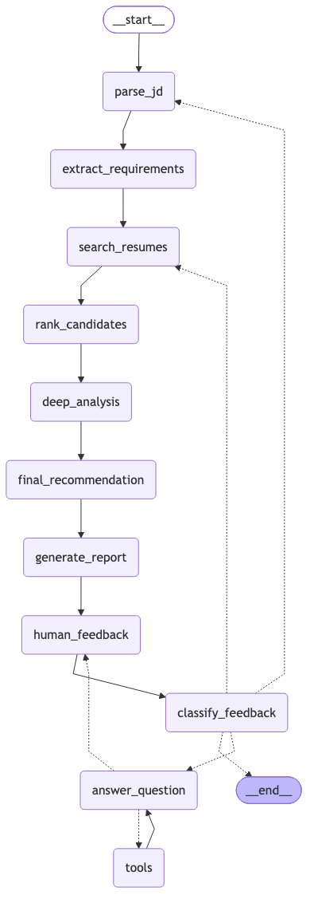

# Agentic Profile Matching (Milestone 3)

A LangGraph agent that screens 100 resumes for a job in three rounds, explains its rankings, re-ranks when you change the requirements mid-conversation, and gives hire / borderline / no-hire recommendations with a detailed match report.

| Part | Technology |
|---|---|
| Agent / state machine | LangGraph (`StateGraph`, checkpointer memory, `interrupt` for the human feedback loop) |
| Reasoning (LLM) | Claude via `langchain-anthropic`, structured output with Pydantic |
| Search (RAG, from Milestone 2) | bge-small embeddings + FAISS + BM25 hybrid search, rule-based 0-100 scoring (open source, runs locally) |
| File tools (from Milestone 1) | read / list / write / search resume files |
| Chat interface | Streamlit (`src/ui/streamlit_app.py`) and terminal (`src/ui/chat_cli.py`) |

**Design idea:** rules for scoring, LLM for reasoning. The Milestone 2 matcher gives fast, reproducible scores and hard must-have filters. Claude handles what rules can't do: understanding requests, deep resume analysis, hire decisions, comparisons and explanations.

## Setup

```bash
uv venv -p 3.12 .venv && uv pip install -p .venv/bin/python -r requirements.txt   # or: python3.12 -m venv .venv && .venv/bin/pip install -r requirements.txt
source .venv/bin/activate
cp .env.example .env              # then add your ANTHROPIC_API_KEY
```

The FAISS index for the 100 resumes is already built in `data/index/`.

## Run

| What | Command |
|---|---|
| **Streamlit chat** | `streamlit run src/ui/streamlit_app.py` |
| Terminal chat | `python -m src.ui.chat_cli` |
| One screening, no chat | `python -m src.agent.matching_agent data/job_descriptions/teacher.txt` |
| State machine diagram | `python -m src.agent.matching_agent --diagram` |
| All tests | `pytest -v` (the conversation tests call Claude and take ~5 min) |
| Milestone 2 matcher only | `python -m src.rag.cli match data/job_descriptions/teacher.txt` |

Run everything from the project root.

### Things to say to the agent
- Start: pick a JD in the sidebar, type a JD name like `it_systems_admin`, or ask *"Find me candidates with SQL and 3+ years experience"*
- *"Compare the top 3 matches side by side"*
- *"Why did Ines Brown rank higher than Elena Reed?"*
- *"Make Linux a must-have"* → re-ranks and explains who moved and why
- *"Drop the Linux requirement and require 10+ years of experience instead"*
- *"Give me interview questions for the top candidate"*
- *"Let's look at a different role: teacher"*
- *"done"*

## State machine



```
START → parse_jd → extract_requirements → search_resumes → rank_candidates
      → deep_analysis → final_recommendation → generate_report → human_feedback ⇄ (pause for the user)
                                                                       ↓
                                                              classify_feedback
              refine  → search_resumes  (re-rank with the new must-haves, explain the changes)
              new_job → parse_jd        (start over with another job)
              question→ answer_question ⇄ tools → human_feedback
              done    → END
```

| Node | What it does | LLM? |
|---|---|---|
| `parse_jd` | Loads a JD file by name/path, or takes pasted text / a one-line request | – |
| `extract_requirements` | Must-have vs nice-to-have, min years, education (structured output) | ✅ |
| `search_resumes` | **Round 1**: hybrid RAG over all 100 resumes, must-have filters, top 10 | – |
| `rank_candidates` | Sorts and compares with the previous ranking: who moved, entered, dropped out and why | – |
| `deep_analysis` | **Round 2**: reads each top-10 resume, strengths / gaps / fit score 1-10 (10 calls in parallel) | ✅ |
| `final_recommendation` | **Round 3**: hire / borderline / no-hire for each, improvement suggestions for borderline | ✅ |
| `generate_report` | Markdown report saved to `reports/`, summary table in the chat | – |
| `human_feedback` | `interrupt()` pauses the graph until the user replies | – |
| `classify_feedback` | refine / new_job / question / done, plus the must-haves to add or remove | ✅ |
| `answer_question` + `tools` | Tool-calling loop for questions, comparisons, interview questions | ✅ |

### Agent state (`src/agent/state.py`)
- **Conversation history:** `messages` (appended with `add_messages`)
- **Job understanding:** `job_description`, `requirements`, `extra_must`, `ignored_must`, `must_applied`
- **Shortlist + reasoning:** `shortlist` (scores, score breakdown, matched/missing skills, reasoning), `previous_shortlist`, `ranking_changes`, `filtered_out`
- **Multi-round results:** `analyses` (round 2), `decisions` (round 3), `report`, `report_path`
- **Feedback loop:** `feedback`

The `InMemorySaver` checkpointer stores the state after every node, keyed by a conversation `thread_id`.

### Tools (`src/agent/tools.py`)
| Tool | Source |
|---|---|
| `list_resumes`, `read_resume`, `search_resume`, `save_report` | Milestone 1 file system tools (path-traversal safe) |
| `rag_search` | Milestone 2 hybrid RAG search with must-have filters |
| `extract_requirements(jd)` | Must-have vs nice-to-have (LLM) |
| `compare_candidates(candidate_ids)` | Head-to-head comparison table + verdict (LLM) |
| `generate_interview_questions(candidate_id)` | 5 screening questions aimed at the candidate's gaps (LLM) |

`compare_candidates` and `generate_interview_questions` get the current job and shortlist through LangGraph's `InjectedState`, so Claude only passes the candidate ids.

## Project layout

```
.env.example  .gitignore  pytest.ini  requirements.txt  README.md   .streamlit/config.toml
data/
  resumes/             100 resume PDFs (10 categories x 10) + _labels.json
  job_descriptions/    8 sample JDs + ground_truth.json
  index/               FAISS index + metadata (rebuild: python -m src.rag.cli build)
docs/                  state machine diagram, test scenarios, demo script
reports/               generated match reports (git-ignored)
scripts/               fetch_resumes.py, build_ground_truth.py
tests/                 test_tools.py (offline), test_scenarios.py (7 conversation flows)
src/
  config/constants.py  every setting: paths, model, scoring weights, agent settings
  file_system/         Milestone 1: fs_tools.py, file_tools.py
  rag/                 Milestone 2: resume_rag.py, job_matcher.py, skills.py, evaluation.py, cli.py
  agent/               Milestone 3: matching_agent.py, state.py, nodes.py, tools.py, schemas.py, llm.py
  ui/                  chat_cli.py, streamlit_app.py, common.py
  exercises/           small learning exercises
```

## Tests

`pytest -v` runs 18 tests:
- `tests/test_tools.py` (11, offline): file tools, path-traversal protection, RAG must-have filters, unknown skills, ranking-change explanations.
- `tests/test_scenarios.py` (7 conversation flows with Claude): natural-language search, compare top 3, explain a ranking, refine and re-rank, multi-round screening, interview questions, switch job then finish. See [docs/TEST_SCENARIOS.md](docs/TEST_SCENARIOS.md).

## Data notes

- 100 resumes, 10 per category, from the Kaggle Resume Dataset (CC0, via HuggingFace `opensporks/resumes`). Names are synthetic. To re-download, run `python scripts/fetch_resumes.py`, then `python scripts/build_ground_truth.py` and `python -m src.rag.cli build`.
- No resume in this dataset mentions Python, and only one mentions React. Skills that are not in the taxonomy (`src/rag/skills.py`) are used for semantic search but not as hard filters, and the agent says so.
- Current Claude models do not accept a `temperature` setting, so answers can vary a little between runs. The tests check the state (who is shortlisted, which tools were called), not exact wording.
